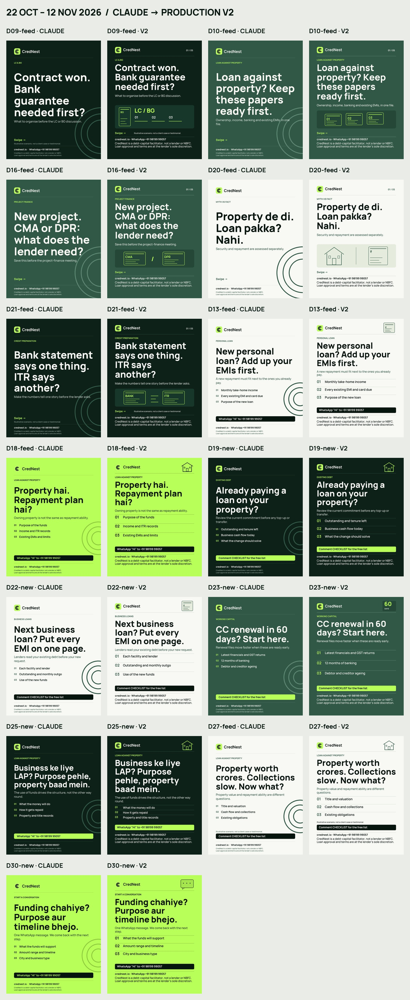

# Hook refresh v2 — review pack

Review before **22 October 2026, 17:00 IST**. D09-feed is scheduled for **19:30 IST** that day. Claude reviews, sets approved items to `ready`, and merges; this branch does not merge or publish anything.



The left image of each pair comes from the applied Claude patch commit `42a5f7c927c529ee32d1c1616a27521290bc62b3`; the right image is the production replacement. [Original-render audit](claude-visual-audit.md) records the findings for every item.

## Production changes

All 13 requested `01.jpg` images were rebuilt. Headlines exactly match `queue.json` topics, including punctuation and Hinglish; only wrapping changes. Kicker, subtitle, all three single-card points and CTA copy remain exactly as supplied in SPECS. Manrope, the supplied transparent logo, the house palette, shared chapter/kicker treatment and topic illustrations replace the decorative rings. No stock people, lender identity or approval badges are used.

Covers use LC/BG documents, a document stack, paired CMA/DPR pages, property versus repayment outlines, and bank/ITR reconciliation pages. Single cards use a rupee ledger, property outlines, a 60-day marker or a message outline. Shorter hooks use larger numbered rows to occupy the middle space.

Each rebuilt slide has the exact contact and full disclaimer, with 30 px contact text and 32 px disclaimer text. All footer ink stays above y=1230, leaving the bottom 120 px clear. Illustrative tags are small on D09, D21 and D27 fronts; the scenario carousels' explanation slides also carry the tag.

## Every additional changed slide

| Carousel | Additional slides |
| --- | --- |
| D09-feed | `media/D09-feed/02.jpg`, `media/D09-feed/03.jpg`, `media/D09-feed/04.jpg`, `media/D09-feed/05.jpg` |
| D10-feed | `media/D10-feed/02.jpg`, `media/D10-feed/03.jpg`, `media/D10-feed/04.jpg`, `media/D10-feed/05.jpg` |
| D16-feed | `media/D16-feed/02.jpg`, `media/D16-feed/03.jpg`, `media/D16-feed/04.jpg`, `media/D16-feed/05.jpg` |
| D20-feed | `media/D20-feed/02.jpg`, `media/D20-feed/03.jpg`, `media/D20-feed/04.jpg`, `media/D20-feed/05.jpg` |
| D21-feed | `media/D21-feed/02.jpg`, `media/D21-feed/03.jpg`, `media/D21-feed/04.jpg`, `media/D21-feed/05.jpg` |

These 20 slides receive matching typography, kicker, chapter numbering and complete footer. Their educational points retain their meaning and support the hooks; no substantive contradiction was found. D09/02 and D21/02 replace the old “Illustrative scenario” headline with a specific subject and move the full scenario label into a small tag.

## Queue and calendar

The 13 visual items have a one-sentence `alt_text` description containing the exact headline; media paths are unchanged and all files exist. All **23 queue items changed by the supplied patch**, including its caption-only changes, are set to `review`. No item was set to `ready`. Captions are identical to the applied Claude patch; publishing times, published items, and all state files are unchanged. The patch includes a caption change for `car-2026-10-21`, outside the requested visual window; its image files were not changed and it is also held for review.

## Sources and caption concerns

- [RBI Governor's Statement, 7 October 2026, paragraph 3](https://www.rbi.org.in/Scripts/BS_PressReleaseDisplay.aspx?prid=63744): repo rate increased 25 basis points to 5.50%; the previous 5.25% follows from the stated increase.
- [CRIF High Mark, September 2026 MSMEx Spotlight](https://www.crifhighmark.com/media/7561/msme-spotlight-report-september-2026.pdf), printed p.05 / PDF p.12: manufacturing portfolio outstanding grew **17.4% YoY as of June 2026**. This is exposure-based MSMEx credit outstanding, not manufacturing output, approval odds or an individual funding entitlement. Cite the September report, not CRIF's June report, which uses April data.
- [Drik Panchang, Mumbai Diwali calendar 2026](https://www.drikpanchang.com/diwali/diwali-puja-calendar.html?geoname-id=1275339&year=2026): **Dhanteras 6 November; Diwali/Lakshmi Puja 8 November 2026**. [Multicultural NSW's 2026 religious calendar](https://multicultural.nsw.gov.au/wp-content/uploads/2026/02/Days-of-Religious-Significance-2026.pdf) corroborates both dates. Recheck November facts during their posting week, as AGENTS.md requires.

Caption concerns for Claude, all preserved unchanged:

- `car-2026-10-23` opens with “6 questions” but enumerates five checklist subjects.
- `D15-feed` and `D28-new` have a Save CTA but neither permitted conversion CTA (CHECKLIST or WhatsApp), as required by the patched AGENTS.md.
- `D27-feed` caption line 1 is exactly 70 characters; the patched hook rule says under 70. Its required image topic remains verbatim.
- The CRIF wording should continue to refer specifically to credit outstanding.

No caption was edited during the visual rebuild.

## Validation and engagement

`python scripts/publish.py --check` prints `OK` both after applying the patch and after the rebuild. Because that command skips `review` media, a separate inspection validated all **33 rebuilt JPEGs**: 1080 × 1350, RGB/sRGB, under 8 MB. All 13 front headlines are 96–104 px and at most four lines. An independent native-size visual review found no overlap, clipping or contradictory carousel copy. [Validation details](validation.json) include each headline and media size.

[Engagement report](engagement-audit.md): the last five Instagram autopilot runs (#47–#43) logged zero new keyword comments handled, with no scope or other engagement errors. `state/engaged.json` remains `{}`. No DM was attempted, so these logs do not confirm DM sending permission or delivery. No engagement code, configuration or state was changed by the visual rebuild; the supplied patch's disclaimer change in `engage.json` is retained.

## Reproduce

```text
python scripts/render_hooks.py --all-slides
python scripts/build_hooks_contact_sheet.py
python scripts/publish.py --check
```

The renderer fails on topic/SPECS mismatch, headlines below 90 px or over four lines, copy overflow, footer overflow and oversized output. It never edits queue metadata or publication state.
