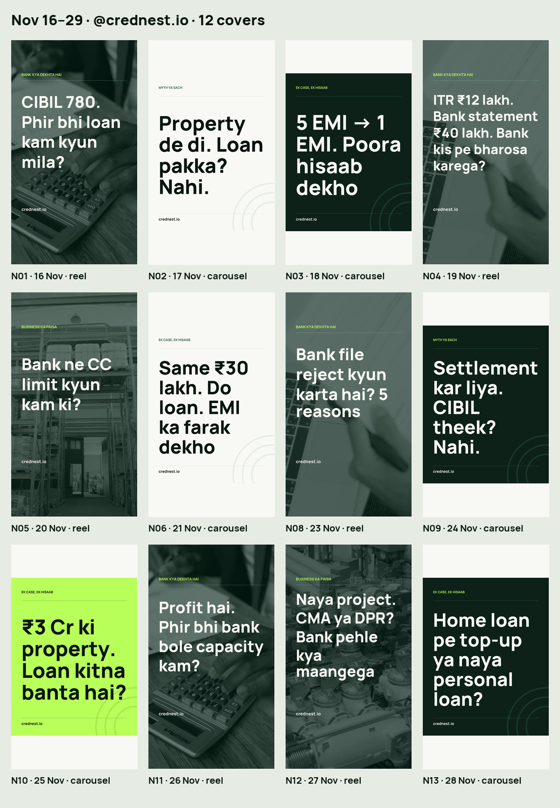

# Nov 16–29: 4-series batch (14 items)

This batch preserves the supplied final copy. It adds six carousels (31 slides), six **silent** reels, and two empty slots reserved for Claude. Carousel status is `review`; reel status is `needs_voice`. Nothing in this batch is marked `ready`.

## Schedule and covers

All new slots use **19:30 IST (+05:30)**.

| ID | Date | Format | Series | Preview |
|---|---|---|---|---|
| N01 | 16 Nov 2026 | Reel | BANK KYA DEKHTA HAI | [Cover](../../media/N01/cover.jpg) |
| N02 | 17 Nov 2026 | Carousel, 5 slides | MYTH YA SACH | [Cover](../../media/N02/01.jpg) |
| N03 | 18 Nov 2026 | Carousel, 6 slides | EK CASE, EK HISAAB | [Cover](../../media/N03/01.jpg) |
| N04 | 19 Nov 2026 | Reel | BANK KYA DEKHTA HAI | [Cover](../../media/N04/cover.jpg) |
| N05 | 20 Nov 2026 | Reel | BUSINESS KA PAISA | [Cover](../../media/N05/cover.jpg) |
| N06 | 21 Nov 2026 | Carousel, 5 slides | EK CASE, EK HISAAB | [Cover](../../media/N06/01.jpg) |
| N07 | 22 Nov 2026 | Reserved, empty | Claude selects N01–N06 best performer | — |
| N08 | 23 Nov 2026 | Reel | BANK KYA DEKHTA HAI | [Cover](../../media/N08/cover.jpg) |
| N09 | 24 Nov 2026 | Carousel, 5 slides | MYTH YA SACH | [Cover](../../media/N09/01.jpg) |
| N10 | 25 Nov 2026 | Carousel, 5 slides | EK CASE, EK HISAAB | [Cover](../../media/N10/01.jpg) |
| N11 | 26 Nov 2026 | Reel | BANK KYA DEKHTA HAI | [Cover](../../media/N11/cover.jpg) |
| N12 | 27 Nov 2026 | Reel | BUSINESS KA PAISA | [Cover](../../media/N12/cover.jpg) |
| N13 | 28 Nov 2026 | Carousel, 5 slides | EK CASE, EK HISAAB | [Cover](../../media/N13/01.jpg) |
| N14 | 29 Nov 2026 | Reserved, empty | Claude selects N08–N13 best performer | — |



## Exact-copy and layout decisions

- The original supplied brief is retained in `batch_nov16_29/BRIEF_SOURCE.txt`; parsed final text is in `batch_nov16_29/batch.json`.
- The user's follow-up supplies the four exact series labels. See `batch_nov16_29/USER_CLARIFICATIONS.md`.
- Covers contain **only the hook, series label and crednest.io**. No logo, phone, disclaimer, example tag, bullet list or extra CTA appears on a cover.
- `Example. Not an offer.` appears on numbered interior slides and reel number cards, including the numbered checklist. It does not appear on covers.
- The 25-word limit applies to main body copy, excluding the supplied CTA, series/website, example tag and required footer. This interpretation was explicitly selected by the user.
- `[END]` is expanded in place in each caption, preserving the original hashtag order and all five supplied hashtags. The batch's final copy overrides the older generic caption/CTA template in AGENTS.md.
- No other queue object or existing asset is changed. `state/published.json` is untouched.

## PR #8 layout and timing fixes

All 31 carousel slides were rebuilt with words positioned on a shared font baseline rather than their individual visible top edges. The render manifest records each line baseline and each word's actual draw anchor, origin and baseline; the independent validator rejects any word that leaves its line baseline.

The two requested layout overrides are limited to N02/04 (heading followed by three numbered items) and N06/04 (separate personal-loan and LAP interest totals, without the separator dot). Each item starts on a new line; a long item may wrap once with continuation text aligned under the item text. Headings and items use the same size, starting at 84px and stepping down by 4px only if the safe area overflows, never below 72px. Numbers and rupee figures remain lime. The supplied source brief, captions, figures and other wording are preserved.

Reels are driven by editable per-scene durations in `reels_nov2026/timings.json`. Their total length is computed from the opening-hook duration, the scene durations and the fixed 1.5-second end card. The renderer, word captions, exported queue timings, media cache and validator all use those timings; there is no fixed fourteen-second duration. See [the retiming instructions](../../reels_nov2026/README.md).

## Important queue overlap

The existing queue already contains approved entries on these dates, including CD04–CD11, CR01–CR03, D23-new, N1128-cc-full and N1129-cma. Several use the same 19:30 slot as this batch. They are intentionally preserved because the brief forbids changing other items. Resolve the overlap during editorial review **before approving the new items**. The new entries cannot auto-publish in their current `review`, `needs_voice` or `needs_content` states.

## Validation and rebuild

```sh
python scripts/build_nov_carousels.py
python scripts/build_nov_reels.py --help
python scripts/build_nov_queue.py --retime
python scripts/build_nov_previews.py
python scripts/check_nov_batch.py
python scripts/publish.py --check
```

For a targeted correction, `python scripts/build_nov_carousels.py --slide N02/04 --slide N06/04` rewrites only those two JPEGs. It merges their updated records into the complete 31-slide manifest and refreshes the review sheets while preserving every other media file.

The independent batch validator checks the new review/voice-pending items, whereas the existing publication checker primarily validates already-ready items. It verifies the exact captions and voice lines, dates, statuses, protected original queue objects, image dimensions/profile/size, silent video format/duration, text manifests, and untouched publication state.

## Audio handoff to Claude

No speech, music, audio API calls or revoice workflows are run in this PR. Voice lines and timings remain in `voice_scenes`; `voice_lang` is `hi-IN`. Initial timings target approximately 16–22 seconds per reel. Claude can replace each scene duration with the measured recorded-voice duration, rebuild the silent video and refresh only its queue timings with `python scripts/build_nov_queue.py --retime`. The opening hook remains visible on frame one, and the end card always occupies the last 1.5 seconds. Test N01 with two Hindi speakers first, as the brief requests for the **later** audio stage. Check intelligibility, full line coverage, video/audio duration and end card before marking an item ready. No words were shortened or omitted.

## Sources and calculation audit

Source notes were checked on **12 November 2026**. Thresholds, rates, tenures and rupee amounts remain the brief's labelled examples, not advertised terms or universal lender rules.

| Items | Primary source | Scope |
|---|---|---|
| N01, N08 | [TransUnion CIBIL: Loan Approval Process](https://www.cibil.com/loan-approval-process) | Credit report, income, payment history and existing obligations are assessment factors; criteria vary by lender and loan. |
| N09 | [TransUnion CIBIL: Impact of Settled Status](https://www.cibil.com/blog/impact-of-settled-status-on-cibil-score) | Distinction between settled and closed accounts and implications for later credit assessment. |
| N02, N10 | [Bank of Baroda: Mortgage Loan](https://bankofbaroda.bank.in/loans/mortgage-loan/baroda-mortgage-loan) | Separate property-value margin and repayment-capacity checks. The brief's 60% and 11% are examples. |
| N04, N05, N08 | [YES Bank: Financial Literacy Module for MSMEs](https://www.yes.bank.in/sites/web/content/published/api/v1.1/assets/CONTB6682FE650FF4BC891CDC03F0A13BD25/native/financial_literacy_module_for_msmes_pdf.pdf?download=false) | Page 4: drawing power from stock/debtors/creditors statements; pages 14–15: documentation and repayment discipline. No universal 25% margin is inferred. |
| N11 | [RBI: Financial Parameters, September 2020](https://www.rbi.org.in/Scripts/NotificationUser.aspx?Id=11961&Mode=0) | DSCR definition only. Historical resolution-framework thresholds are not treated as current general approval criteria. |
| N04, N08, N12 | [Union Bank of India: FAQs on Commercial Loans](https://www.unionbankofindia.bank.in/en/details/faqs-on-commercial-loans) | CMA/projections, project report and financial/banking documents serve complementary purposes. |

These sources support the general mechanics. They do not establish the statistical wording “most lenders” in N04/N12, rank hidden loans as the largest cause of rejection in N08, or mandate DPR-before-CMA for all projects. The supplied final copy is retained for editorial review.

EMI uses `P × r × (1+r)^n / ((1+r)^n − 1)`, with monthly `r = annual percentage / 100 / 12`; totals use unrounded EMI before rupee rounding.

| Item | Independently verified result |
|---|---|
| N01 | ₹1,00,000 × 50% − ₹35,000 = ₹15,000 new EMI room |
| N03 | ₹40 lakh, 11%, 180 months: EMI ₹45,464; reduction ₹99,536; interest ₹41,83,498 |
| N05 | (₹60L + ₹40L − ₹30L) × 75% = ₹52.5L drawing power |
| N06 | ₹30 lakh: 16%/60 months EMI ₹72,954, interest ₹13,77,250; 11%/180 months EMI ₹34,098, interest ₹31,37,623 |
| N10 | 60% of ₹3 Cr = ₹1.8 Cr; ₹1,20,000 EMI at 11%/180 months supports ₹1,05,57,832 ≈ ₹1.06 Cr |
| N11 | ₹30L / ₹25L = 1.2 |
| N13 | ₹10 lakh: 9.5%/120 months EMI ₹12,940, interest ₹5,52,771; 15%/60 months EMI ₹23,790, interest ₹4,27,396 |

Licensed, face-free Pexels stock sources, source hashes and reuse/crop notes are recorded under `reels_nov2026/`. See [Pexels License](https://www.pexels.com/license/).
